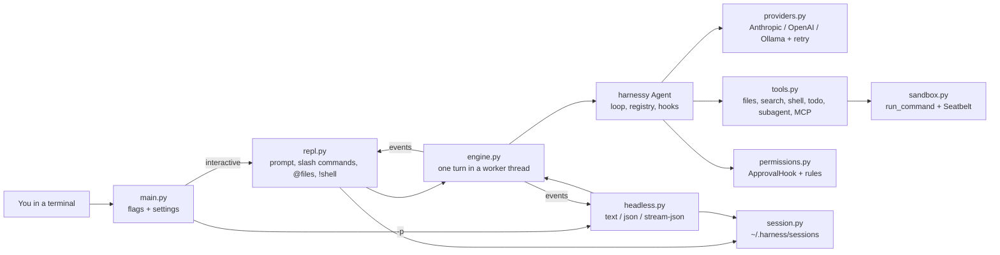
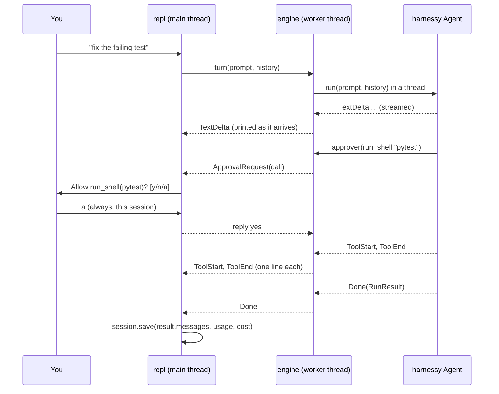

# harness-cli design

Status: v0.1 design, 2026-10-03. Approach A from [approaches.md](approaches.md): a
line-based CLI on top of the harnessy library.

## Goal

Type `harness` in any project folder and get a coding agent that works like Claude
Code or Codex: a multi-turn chat that reads and edits files, runs shell commands after
asking, streams its answer, remembers the conversation, and can also run once from a
script with `harness -p "..."`. Every agent behaviour comes from harnessy; the CLI adds
only what a program needs.

**Success criteria**

1. `harness` opens a chat in the current folder; the agent can list, search, read, edit
   and write files and run shell commands there, and nothing outside it.
2. Edits and shell commands ask first in the default mode; the four permission modes and
   allow/deny rules change that without code changes.
3. `harness -p "task"` runs once with no prompts, prints text, JSON or JSON lines, and
   exits non-zero when the run didn't finish cleanly.
4. `harness -c` continues the last conversation in this folder; `harness -r <id>` resumes
   a named one.
5. The whole CLI is tested with `ScriptedModel`: no keys, no network.

**Out of scope for v0.1** (see the roadmap in [PLAN.md](PLAN.md)): a full-screen TUI,
an agent server, skills, hooks configured from settings, git checkpoints/undo, images.

## Architecture



## Units

Each file has one job and can be tested without the others.

| Unit | Does | Depends on |
| --- | --- | --- |
| `config.py` | `Settings`: defaults ← `~/.harness/settings.json` ← `<project>/.harness/settings.json` ← flags | stdlib |
| `providers.py` | `make_model(provider, model)` → harnessy model wrapped in `RetryingModel` | harnessy.models |
| `instructions.py` | Builds the system prompt: base prompt + environment + `HARNESS.md`/`AGENTS.md`/`CLAUDE.md` | stdlib |
| `sandbox.py` | Seatbelt profile and `run_sandboxed(command, workspace, mode)` | harnessy.tools.sandbox |
| `tools.py` | `build_tools(...)`: read/write/edit/list/search files, `run_shell`, `todo`, `spawn_subagent`, MCP tools | harnessy.tools, todo, subagents, mcp |
| `permissions.py` | Modes → `ApprovalHook` policy; `Rule` matching like `run_shell(git status*)`; `Approver` that consults rules, then the human | harnessy.approvals |
| `engine.py` | `Engine.turn(prompt, history)` → iterator of events; cancel on Ctrl-C | harnessy.loop, streaming |
| `session.py` | `Session` save/load as JSON lines; `latest(project)`, `list(project)` | harnessy.tracer.to_jsonable |
| `commands.py` | Slash command registry, custom commands from `.harness/commands/*.md`, `@file` expansion | stdlib |
| `render.py` | Colours, tool lines, approval prompt, cost line | stdlib |
| `repl.py` | The interactive loop | all of the above |
| `headless.py` | `-p` mode and its three output formats | engine, session |
| `main.py` | Flag parsing, wiring, exit codes | all |

### The one library change

`Agent.run(task, history=None)` and `Agent.stream(task, history=None)`: when `history`
is given, the run starts from `[*history, Message("user", task)]` instead of
`[Message("user", task)]`. `RunResult.messages` is then the whole conversation, which is
exactly what the session saves. Old callers pass nothing and see no change.

## Data flow of one turn



Approval prompts travel through the same queue as the streamed text. The worker thread
puts an `ApprovalRequest` with a reply queue on the event queue and waits; the main
thread has already printed everything before it, asks, and puts the answer back. That
keeps prompts and streamed text in order.

## Permissions

Tools fall into three kinds:

| Kind | Tools |
| --- | --- |
| read | `read_file`, `list_files`, `search_files`, `todo` |
| edit | `write_file`, `edit_file` |
| execute | `run_shell`, every MCP tool |

`spawn_subagent` is allowed in every mode except plan: the child gets the same
`ApprovalHook`, so a subagent asks for exactly what its parent would have to ask for.

| Mode | read | edit | execute | Like |
| --- | --- | --- | --- | --- |
| `default` | allow | ask | ask | Claude Code default; Codex `auto` |
| `accept-edits` | allow | allow | ask | Claude Code `acceptEdits` |
| `plan` | allow | deny | deny | Claude Code plan mode; Codex `read-only` |
| `bypass` | allow | allow | allow* | `--dangerously-skip-permissions`; Codex full access |

\* In bypass, execute tools still go through the `ApprovalHook` with decision `ask`, but
with an approver that always says yes. The lethal-trifecta check (week 7) therefore still
passes for a stated reason, and turning approvals off stays a named, visible choice.

**Rules** in settings refine an `ask`:

```json
{ "permissions": {
    "allow": ["run_shell(git status*)", "run_shell(uv run pytest*)"],
    "deny":  ["run_shell(rm -rf*)", "write_file(.env*)"]
}}
```

A rule is `tool` or `tool(pattern)`, matched with `fnmatch` against the call's main
argument (`command` for `run_shell`, `path` for file tools). Order: a matching deny rule
says no; a matching allow rule says yes; a tool in `allow` by bare name becomes `allow`
in the policy table; otherwise the human is asked. In `-p` mode nobody can be asked, so
an unmatched `ask` is declined and the model is told why.

At an interactive prompt the answers are `y` (once), `n` (no), and `a` (always allow this
tool for the rest of the session).

## Sandbox

`run_shell` uses harnessy's `run_command` (scrubbed environment, `HOME` set to the
workspace, a real timeout, capped output). On macOS, when `sandbox-exec` exists and the
sandbox mode is `workspace-write` (the default), the command also runs inside a Seatbelt
profile: no network, no writes outside the workspace and temp folders, no reads of
`~/.ssh`, `~/.aws`, `~/.gnupg` or `~/.harness`. `--sandbox off` drops the OS layer. The
two layers and their limits are described in harnessy's `docs/sandbox.md`.

## Sessions

`~/.harness/sessions/<project-key>/<id>.jsonl`, where the project key is the workspace
path with `/` turned into `-`. Line 1 is a header (`id`, `workspace`, `created`,
`provider`, `model`); each later line is one `Message` in harnessy's JSON form. After
every turn the new messages are appended, plus a `usage` line. `--continue` loads the
newest file for the folder; `--resume <id>` loads that id (a prefix is enough).

## Slash commands

| Command | Does |
| --- | --- |
| `/help` | List commands, including custom ones |
| `/clear` | Start a new conversation (new session id) |
| `/compact [focus]` | Replace the history with a model-written summary |
| `/cost` | Tokens and dollars for this session |
| `/model [name]` | Show or switch the model |
| `/mode [mode]` | Show or switch the permission mode |
| `/tools` | List tools and their current decision |
| `/todo` | Show the agent's todo list |
| `/sessions` | List saved sessions for this folder |
| `/resume <id>` | Switch to a saved session |
| `/init` | Ask the agent to write a `HARNESS.md` for this project |
| `/exit` | Quit (also Ctrl-D) |

Custom commands are Markdown files in `.harness/commands/` (project) or
`~/.harness/commands/` (user). `/name some words` sends the file's text with
`$ARGUMENTS` replaced by `some words`. An optional first line `description: ...` shows
in `/help`.

Other input shortcuts: `!command` runs a shell command directly (through the same
sandbox, no model call) and shows the output; `@path/to/file` inside a prompt attaches
that file's contents; a line ending in `\` continues on the next line.

## Headless mode

`harness -p "prompt"` (the prompt may also come from stdin) runs one turn and exits.

| `--output-format` | Prints |
| --- | --- |
| `text` (default) | the final answer |
| `json` | one object: `result`, `stop_reason`, `session_id`, `steps`, `usage`, `cost_usd`, `error` |
| `stream-json` | one JSON line per event (`text`, `tool_start`, `tool_end`, `done`) |

Exit codes: `0` the run ended with `end_turn`; `1` any other stop (limit, error,
blocked); `2` bad flags or settings.

## Error handling

- Model errors, limits and blocked calls already end the loop cleanly with a stop
  reason; the CLI prints the reason and keeps the session.
- A missing API key or model name is reported in one line at startup, before the prompt.
- Settings files with bad JSON stop the CLI with the file path and the parser message
  (exit 2), never a traceback.
- Ctrl-C during a turn cancels it at the next model or tool boundary; a second Ctrl-C
  within a turn exits. Ctrl-C at an empty prompt clears the line; Ctrl-D exits.
- An MCP server that fails to start is reported and skipped; the session goes on
  without its tools.

## Testing

All with `ScriptedModel` and temporary folders: settings merging and errors; rule
matching and mode tables; the approver (rules, prompt answers, "always", headless
decline); the engine (multi-turn history, approval round trip through the queue,
cancel); session save/load round trip, `latest`, prefix resume; slash command parsing,
custom commands and `@file` expansion; headless output formats and exit codes; the
Seatbelt sandbox on macOS (skipped elsewhere). The existing 325 harnessy tests must
stay green.
